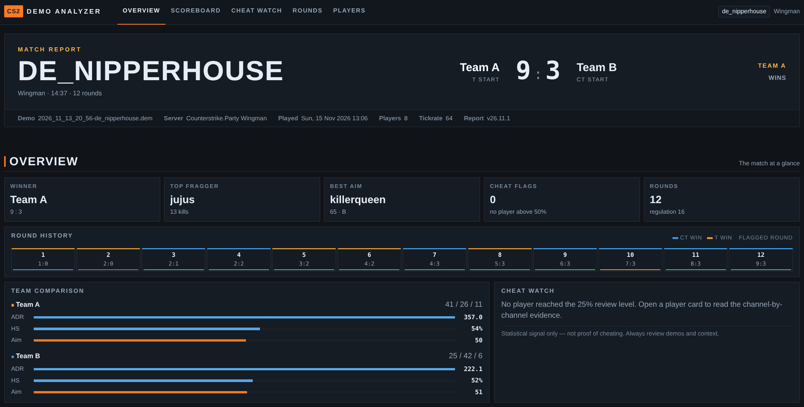

# CS2 Demo Analyzer

Turn Counter-Strike 2 demo files into a **single, self-contained HTML report**:
match statistics, per-player performance, a Leetify-style aim profile, and a
probabilistic anti-cheat analysis. No server, database, or internet connection
is needed — one demo goes in, one `<demo>.html` comes out.



*The report combines a match overview, scoreboard, round-by-round timeline,
player cards, aim metrics, and timestamped cheat-analysis review cues.*

## What this project aims to do

CS2 Demo Analyzer is built for the demo files you get after a match — from
your own games, a team scrim, a league server, or a GOTV recording. It reads
the demo directly and produces a dark, information-dense report that is easy to
share and works offline.

It has two complementary goals:

1. **Explain the match.** Show what happened in a readable, information-dense
   layout: the score, every round, the economy, kills, utility, plants,
   defuses, and each player's contribution.
2. **Surface statistical cheat signals.** Run a separate, vendored anti-cheat
   detector over the demo and present its channels, confidence values, review
   cues, and a clearly labelled probabilistic verdict.

The cheat analysis is a **review aid, not proof**. It is deliberately shown with
raw values, sample counts, confidence, and a disclaimer so that a flag starts an
investigation instead of ending one.

The tool accepts CS2 (Source 2) demos only. CS:GO (Source 1) demos are rejected
with a clear error. Reports are one match per file; there is no cross-demo
history or player database.

## What it analyzes

| Data | What the report shows |
|---|---|
| Match overview | Map, game mode, date, final score, winner, teams, tickrate, player count, parser version |
| Scoreboard | Both teams with kills, deaths, assists, ADR, headshot %, MVP count, and aim rating |
| Rounds | Warmup, regulation, and overtime; round result, score, buy type/economy, duration, MVP |
| Event timeline | Kills, headshots, wallbangs, no-scopes, smoke kills, plants, defuses, utility, and other round events; filter by event type or player |
| Player statistics | Aggregate stats plus T/CT side splits, weapon accuracy, and a per-round table |
| Aim profile | Damage speed, reaction, preaim, accuracy, head accuracy, counter-strafe, spray, and a weighted composite rating with grade |
| Cheat analysis | Ten scored detector channels with raw value, score, confidence, zone, plus narrative and score modifiers |
| Review cues | Timestamped suspicious moments linked to the round timeline and copyable as `demo_gototick <tick>` |
| Match navigation | Round history strip, player links, cheat-watch cards, demo download, and an optional report index |
| Outputs | Self-contained HTML, optional JSON sidecar, optional `index.html`, watch cache manifest |

The aim profile and the cheat detector are independent. Aim metrics describe
performance and do **not** feed the cheat score.

## Installation

### Option 1: Linux install script

Install the latest release into `/opt/cs2-demo-analyzer` with a
`/usr/local/bin/cs2-demo-analyzer` symlink:

```sh
curl -fsSL https://raw.githubusercontent.com/Kandru/cs2-demo-analyzer/main/install.sh | sudo sh
# or
wget -qO- https://raw.githubusercontent.com/Kandru/cs2-demo-analyzer/main/install.sh | sudo sh
```

The script detects `amd64`, `arm64`, or `386`, verifies `SHA256SUMS`, and
installs the static binary. See [docs/install.md](docs/install.md) for pinning,
custom directories, upgrade, and uninstall.

### Option 2: prebuilt release binaries

Download the archive for your platform from the
[GitHub releases page](https://github.com/Kandru/cs2-demo-analyzer/releases).
Release archives are built for Linux (`amd64`, `arm64`, `386`), Windows
(`amd64`, `arm64`), and macOS (`amd64`, `arm64`).

```sh
# Linux/macOS
tar -xzf cs2-demo-analyzer-<version>-linux-amd64.tar.gz
cd cs2-demo-analyzer-<version>-linux-amd64
./cs2-demo-analyzer version
```

```powershell
# Windows PowerShell
tar -xzf cs2-demo-analyzer-<version>-windows-amd64.tar.gz
cd cs2-demo-analyzer-<version>-windows-amd64
.\cs2-demo-analyzer.exe version
```

Each release includes `SHA256SUMS`, `README.md`, and `VERSION`. Verify a
download before running it:

```sh
grep 'linux-amd64.tar.gz' SHA256SUMS | sha256sum -c -
```

### Option 3: Docker

There is no published registry image; build it from this repository. The
runtime image is small and contains only the static binary, CA certificates,
and timezone data.

```sh
make docker-build
# or:
docker build -t cs2-demo-analyzer:latest .
```

Run a one-shot analysis:

```sh
mkdir -p demos reports
docker run --rm --user "$(id -u):$(id -g)" \
  -v "$PWD/demos":/demos:ro \
  -v "$PWD/reports":/out \
  cs2-demo-analyzer:latest analyze --input /demos --output /out
```

Run the default long-running watcher:

```sh
docker run --rm --user "$(id -u):$(id -g)" \
  -v "$PWD/demos":/demos:ro \
  -v "$PWD/reports":/out \
  cs2-demo-analyzer:latest
```

The container image itself runs as root by default. The `make` Docker targets
pass `--user "$(id -u):$(id -g)"`, so `dist/`, reports, and edited Go files
stay owned by you; Go caches live in `.cache/` on the host. For a raw
`docker run`, add `--user "$(id -u):$(id -g)"` to get the same ownership.

### Option 4: Docker Compose

The included `docker-compose.yml` watches `./demos` and writes to `./reports`:

```sh
mkdir -p demos reports
docker compose up -d --build
docker compose logs -f
```

Edit the volume list in `docker-compose.yml` if your demo and report
directories live elsewhere. Keep `--workers` low for large GOTV demos.

### Option 5: build from source

The normal build path uses Docker, so no local Go toolchain is required:

```sh
make build        # dist/cs2-demo-analyzer (linux/amd64)
make test         # go test ./... inside golang:1.27.4
make vet
make audit        # go mod verify + govulncheck
```

If you already have Go 1.27.4 or newer, use `make build-local`. You can also run
directly from `src/`:

```sh
cd src
go run ./cmd/cs2-demo-analyzer analyze ../stuff/match.dem
```

### Requirements

- A CS2 demo: `.dem`, `.dem.gz`, or `.dem.bz2`.
- No runtime dependencies beyond the binary.
- Docker only if you build or test through the provided Make targets.
- Memory: assume roughly 0.5–1 GB peak per concurrent worker for large demos.
  Start with `--workers 1` in a container.

## Configuration

There is no config file. Settings come from command-line flags, environment
variables, and built-in defaults, in that order:

```text
command-line flags  >  CS2_DEMO_ANALYZER_* environment variables  >  defaults
```

### Command-line flags

| Flag | Default | Used by | Meaning |
|---|---|---|---|
| `-i, --input PATH` | — | `analyze`, `watch` | Input demo or directory. Repeatable. Positional arguments are also accepted. |
| `-o, --output DIR` | demo directory | `analyze`, `watch` | Report output directory. Created if missing. |
| `--recursive` | `true` | `analyze`, `watch` | Recurse into input subdirectories. Use `--recursive=false` for one level. |
| `--workers N` | `min(4, CPU)` / `1` | `analyze`, `watch` | Parallel demo processors. Each worker uses substantial memory. `watch` defaults to `1`. |
| `--json` | `false` | `analyze`, `watch` | Write a JSON sidecar next to each HTML report. |
| `--index` | `false` | `analyze`, `watch` | Write `index.html` listing reports in each report directory. Automatic when reports sit next to their demos. |
| `--demo-download` | `false` | `analyze`, `watch` | Link the source demo for download even when it is outside the report directory. Same-directory links are always enabled. |
| `--cheat` | `true` | `analyze`, `watch` | Run the anti-cheat detector as a second parse pass. Disable with `--cheat=false`. |
| `--aim` | `true` | `analyze`, `watch` | Collect aim statistics. Disable with `--aim=false`. |
| `--force` | `false` | `analyze`, `watch`, `update` | Reprocess unchanged demos and bypass `watch` cache entries; on `update`, reinstall the latest release. |
| `--update` | `false` | `analyze`, `watch` | Check GitHub and self-update before running. A failed update warns but does not stop processing. |
| `--check` | `false` | `update` | Only report whether a newer release is available. |
| `--timeout` | `15m` | `analyze`, `watch` | Per-demo timeout, including both parse passes. |
| `--interval` | `5s` | `watch` | Fallback rescan interval. |
| `--debounce` | `2s` | `watch` | Settle/debounce window before scanning. |
| `--quiet` | `false` | `analyze`, `watch` | Log errors only. |
| `--verbose` | `false` | `analyze`, `watch` | Debug logging, queue decisions, and parse timings. |

### Environment variables

| Variable | Meaning |
|---|---|
| `CS2_DEMO_ANALYZER_INPUT` | OS path-list separated inputs: `:` on Linux/macOS, `;` on Windows. |
| `CS2_DEMO_ANALYZER_OUTPUT` | Output directory. |
| `CS2_DEMO_ANALYZER_JSON` | `true`/`false` for the JSON sidecar. |
| `CS2_DEMO_ANALYZER_INDEX` | `true`/`false` for report indexes. |
| `CS2_DEMO_ANALYZER_DEMO_DOWNLOAD` | `true`/`false` for demo download links. |
| `CS2_DEMO_ANALYZER_CHEAT` | `true`/`false` to enable or disable anti-cheat analysis. |
| `CS2_DEMO_ANALYZER_AIM` | `true`/`false` to enable or disable aim statistics. |
| `CS2_DEMO_ANALYZER_UPDATE` | `true`/`false`; update before `analyze`/`watch`. |

Flags override environment values. For example:

```sh
export CS2_DEMO_ANALYZER_INPUT="/srv/cs2/demos"
export CS2_DEMO_ANALYZER_OUTPUT="/srv/cs2/reports"
cs2-demo-analyzer analyze --workers 2
```

### Output layout

- `<base>.html` — self-contained report. `<base>` strips `.dem`, `.dem.gz`,
  and `.dem.bz2`.
- `<base>.json` — optional machine-readable sidecar (`--json`).
- `index.html` — report list for a report directory, grouped by server and
  sorted newest first.
- `<manifest-dir>/.cs2-demo-analyzer/manifest.json` — `watch` cache.

Reports go next to each demo unless `--output` is set. When the report
directory receives an `index.html`, it uses the same self-contained design and
shared stylesheet as the reports, and each detailed report links back to the
index. Demo download links point at the original `.dem` path; move or delete
demos accordingly.

The `watch` manifest directory is `--output` when set, otherwise the first
input directory, or the current directory for a single-file input.

## Usage variations

### Analyze one demo

```sh
cs2-demo-analyzer analyze ./demos/match.dem
# writes ./demos/match.html and an index next to it
```

### Analyze a directory

```sh
cs2-demo-analyzer analyze ./demos
```

### Analyze several inputs at once

```sh
cs2-demo-analyzer analyze \
  --input ./demos/league \
  --input ./demos/scrims/match.dem \
  ./demos/tournament
```

### Write all reports to one directory

```sh
cs2-demo-analyzer analyze \
  --output ./reports \
  --index \
  --json \
  --demo-download \
  ./demos
```

This writes `./reports/<base>.html`, `./reports/<base>.json`, and a single
`./reports/index.html`. If two demos share a basename, the later report gets a
short source hash suffix to avoid overwriting.

### Scan only the top level

```sh
cs2-demo-analyzer analyze --recursive=false ./demos
```

### Watch a directory continuously

```sh
cs2-demo-analyzer watch --input ./demos --output ./reports
```

A new file is queued only after its size and modification time are stable on
two consecutive scans, so downloads in progress are not parsed. Successful
reports are skipped while the demo, tool version, report options, and report
file are unchanged. Broken demos are cached and retried only when the file
changes or `--force` is used.

### Tune the watcher

```sh
cs2-demo-analyzer watch \
  --input /srv/cs2/demos \
  --output /srv/cs2/reports \
  --workers 1 \
  --interval 10s \
  --debounce 3s
```

### Reduce work: statistics only

```sh
cs2-demo-analyzer analyze --cheat=false ./demos
```

This skips the second parse pass and the anti-cheat card, which is the fastest
way to generate match reports.

### Reduce work: no aim profile

```sh
cs2-demo-analyzer analyze --aim=false ./demos
```

### Reprocess everything

```sh
cs2-demo-analyzer watch --input ./demos --output ./reports --force
```

### Tune concurrency and timeouts

```sh
cs2-demo-analyzer analyze --workers 1 --timeout 30m ./demos
```

Use fewer workers when memory is tight or demos are very large. Use a longer
timeout for unusually long matches or slow storage.

### Quiet or debug output

```sh
cs2-demo-analyzer analyze --quiet ./demos
cs2-demo-analyzer analyze --verbose ./demos
```

### Check for or install an update

```sh
# report current/latest without changing anything
cs2-demo-analyzer update --check

# install the latest release (root-owned installs need sudo)
sudo cs2-demo-analyzer update

# update before a batch run
cs2-demo-analyzer analyze --update ./demos
```

Ordinary `analyze`/`watch` runs never contact the network. The updater selects
the archive for your OS/architecture, verifies `SHA256SUMS`, and atomically
replaces the current binary. Windows self-update is not supported; use the
release archive instead.

### Docker one-shot and watcher

```sh
# one-shot
docker run --rm --user "$(id -u):$(id -g)" \
  -v "$PWD/demos":/demos:ro -v "$PWD/reports":/out \
  cs2-demo-analyzer:latest analyze --input /demos --output /out

# watcher
docker run --rm --user "$(id -u):$(id -g)" \
  -v "$PWD/demos":/demos:ro -v "$PWD/reports":/out \
  cs2-demo-analyzer:latest watch --input /demos --output /out --workers 1
```

### Make targets

| Command | Effect |
|---|---|
| `make` | Show available targets and the current version. |
| `make build` | Build `dist/cs2-demo-analyzer` for linux/amd64 in Docker. |
| `make build-local` | Build with a local Go toolchain. |
| `make test` | Run all Go tests in Docker. |
| `make fmt` / `make vet` | Format or vet Go code in Docker. |
| `make check-install` | Validate `install.sh` shell syntax. |
| `make release` | Cross-compile all release archives into `dist/` in Docker. |
| `make release-local` | Cross-compile all release archives with a local Go toolchain. |
| `make docker-build` | Build the runtime Docker image. |
| `make analyze` | Analyze everything in `./stuff` into `./reports`. |
| `make watch` | Watch `./stuff` and write reports into `./reports`. |
| `make version` | Print `VERSION`. |
| `make version-bump` | Increment the `YY.MM.BuildNr` version. |
| `make clean` | Remove `dist/` and local caches. |

### Exit codes

| Code | Meaning |
|---|---|
| `0` | Success. |
| `1` | One or more demos failed, or processing was cancelled. |
| `2` | Usage or configuration error. |

## Inside the report

The HTML report is one file with inline CSS, JavaScript, and SVG. It has no
external fonts, images, scripts, or network requests, and it can be opened
directly from disk or shared as an attachment.

- **Overview** — winner, score, top fraggers, best aim, cheat flags, team
  comparison, and warnings.
- **Scoreboard** — both teams with K/D/A, ADR, HS%, MVPs, and aim rating.
- **Cheat watch** — flagged and review-level players with why and when.
- **Rounds** — every round with economy, timeline, plants, defuses, utility,
  MVP, and event filters.
- **Players** — aggregate and side-split stats, aim tiles, weapon accuracy,
  cheat channels, review cues, and per-round results.

### Aim profile

Seven descriptive metrics feed the composite aim rating:

| Metric | Weight |
|---|---|
| Damage speed | 20 |
| Reaction | 20 |
| Preaim | 15 |
| Accuracy | 20 |
| Head accuracy | 10 |
| Counter-strafe | 5 |
| Spray | 10 |

Each available metric is scored from fixed anchors. Missing metrics are dropped
and the remaining weights are renormalized; a rating needs at least three
components. Grades range from `A+` (≥85) to `F` (below 25). Aim metrics are
descriptive and never influence the cheat score.

### Cheat analysis

The detector uses ten scored channels — headshot rate, snap velocity, reaction
time, sub-100 ms engagements, recoil, pre-FOV aim, pre-FOV presence, idle
attention, deaths while looking away, and attention/pre-FOV decoupling — plus
modifiers for lobby type, scoreboard position, evidence stacking, wallhack
co-occurrence, the sub-100 ms floor, and sniper-specific overrides.

Each player card shows the final likelihood (0–100), per-channel raw values and
confidence, the detector narrative, score adjustments, and timestamped review
cues. The flag threshold is a likelihood of 50.

> **Important:** the detector is probabilistic, tuned on a small reference
> corpus, and uses server-side radar spotting as an approximation of screen
> visibility. It is **not proof of cheating** and must not be used as the sole
> basis for accusations or bans. Read
> [docs/anticheat.md](docs/anticheat.md) before acting on a flag.

## Documentation

| Document | Contents |
|---|---|
| [docs/README.md](docs/README.md) | Documentation index and reading order |
| [docs/install.md](docs/install.md) | Linux installer, self-update, upgrade and uninstall |
| [docs/cli.md](docs/cli.md) | Complete CLI reference, environment variables, exit codes |
| [docs/watching.md](docs/watching.md) | Watch lifecycle, cache, manifest, Docker mounts |
| [docs/architecture.md](docs/architecture.md) | Pipeline and package boundaries |
| [docs/parser.md](docs/parser.md) | Demo parsing, round model, edge cases |
| [docs/report-schema.md](docs/report-schema.md) | HTML/JSON data contract |
| [docs/report-ui.md](docs/report-ui.md) | Report sections, design tokens, accessibility |
| [docs/aim-metrics.md](docs/aim-metrics.md) | Composite aim rating and shared rules |
| [docs/aim/](docs/aim/README.md) | One page per aim metric |
| [docs/anticheat.md](docs/anticheat.md) | Detector overview, integration patches, limits |
| [docs/detections/](docs/detections/README.md) | One page per cheat channel and modifier |
| [docs/testing.md](docs/testing.md) | Tests, docs-sync checks, demo fixtures |
| [docs/releasing.md](docs/releasing.md) | Version scheme and release workflow |
| [docs/THIRD_PARTY.md](docs/THIRD_PARTY.md) | Vendored code and licenses |

Every Go package also has an `AGENTS.md` with local invariants and extension
instructions.

## Versioning and releases

`VERSION` uses `YY.MM.BuildNr`, for example `26.11.1`. The build number
increments within a month and resets to `1` on the first of the next month.
Pushing a `VERSION` change to `main` triggers the release workflow, which
cross-compiles the supported platforms, attaches `SHA256SUMS`, and keeps the
five newest releases.

See [docs/releasing.md](docs/releasing.md).

## Third-party notice

The anti-cheat detector is a vendored copy of
[`TimAnthonyAlexander/demo-anticheat`](https://github.com/TimAnthonyAlexander/demo-anticheat).
The upstream repository has no license file at the pinned commit. If you
redistribute this project, confirm permission with the upstream author. See
[docs/THIRD_PARTY.md](docs/THIRD_PARTY.md).
